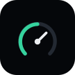
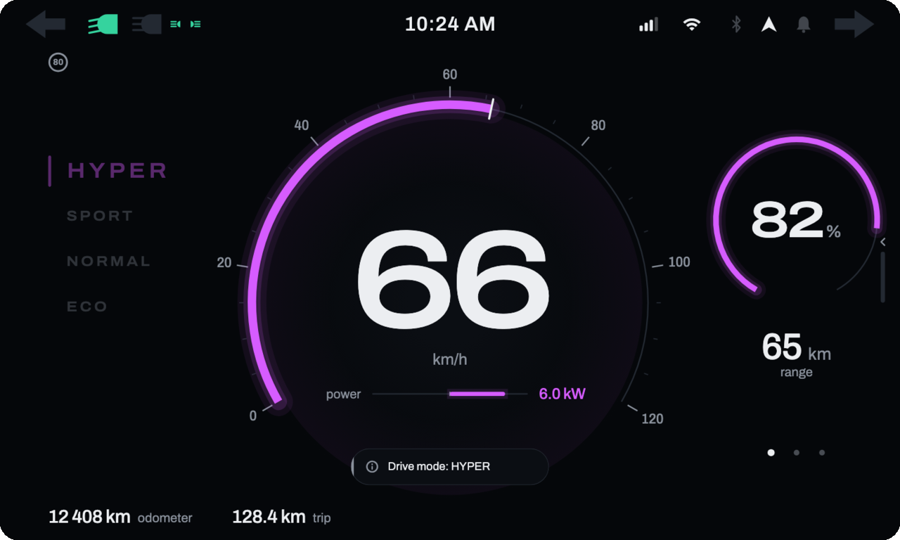
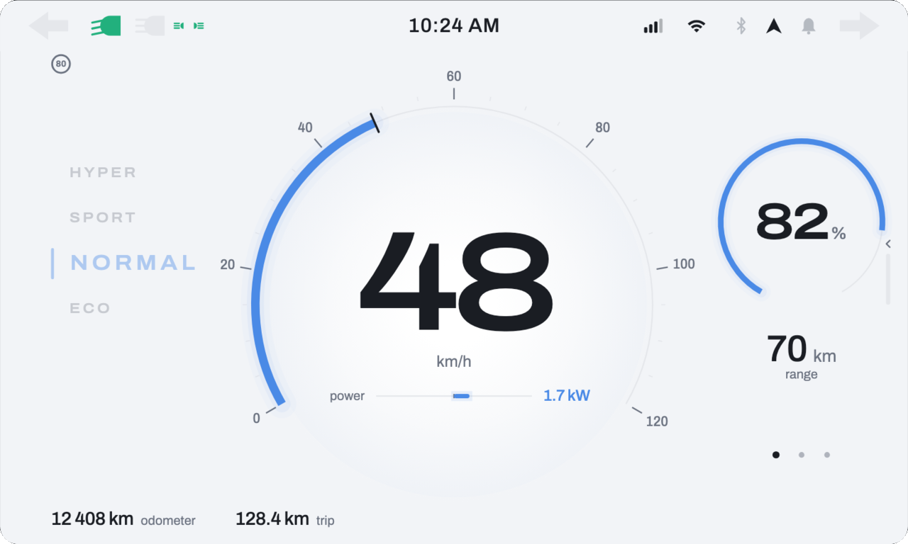
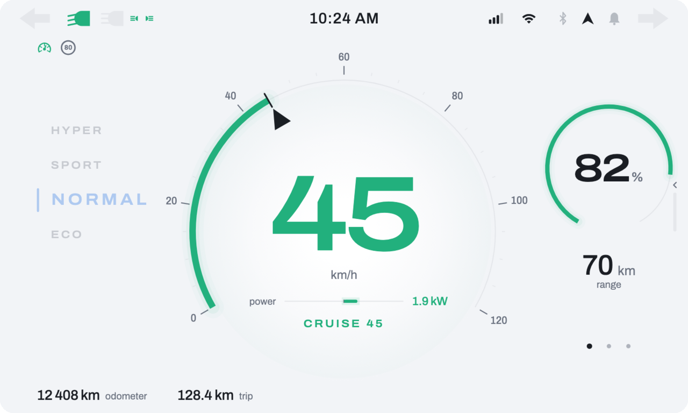
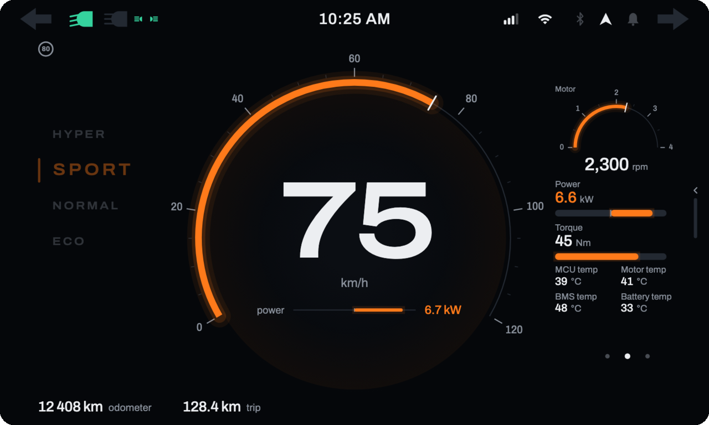
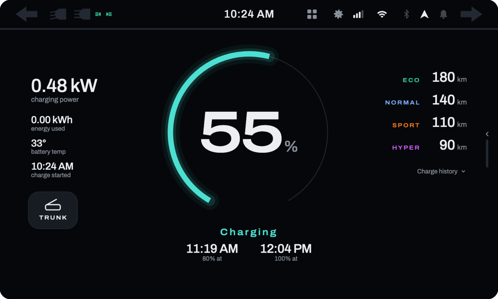
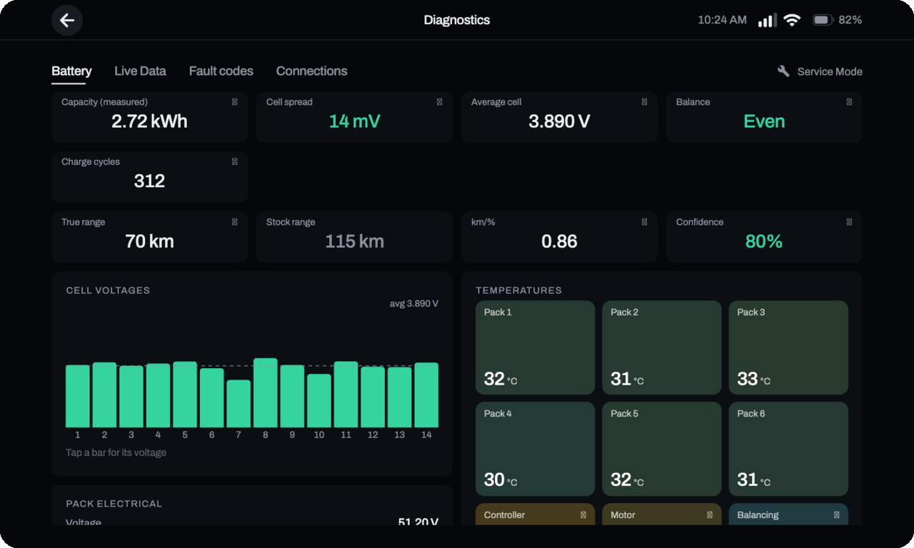
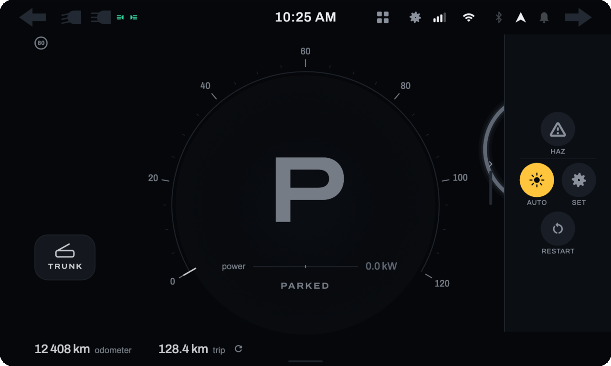
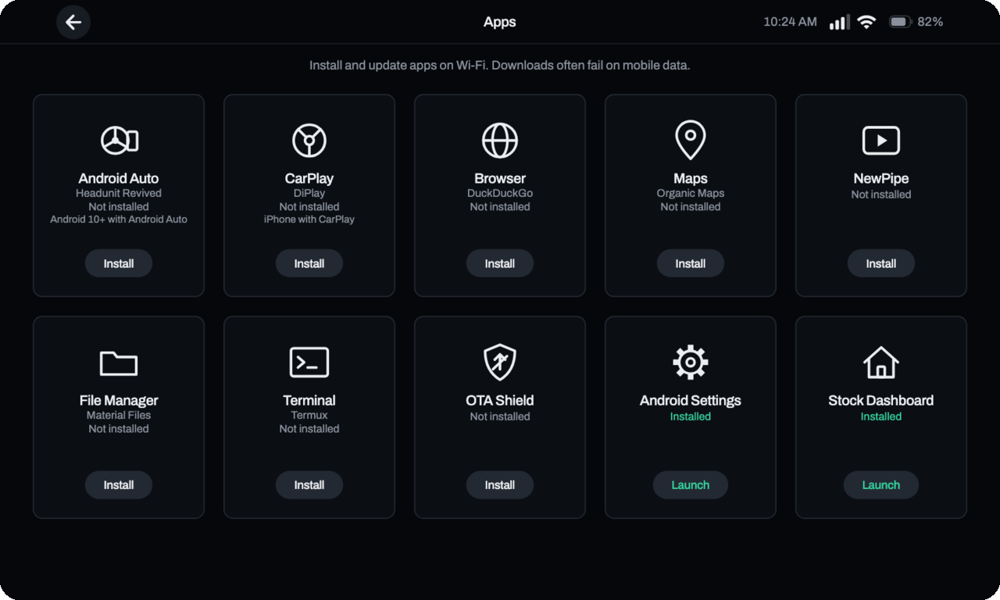
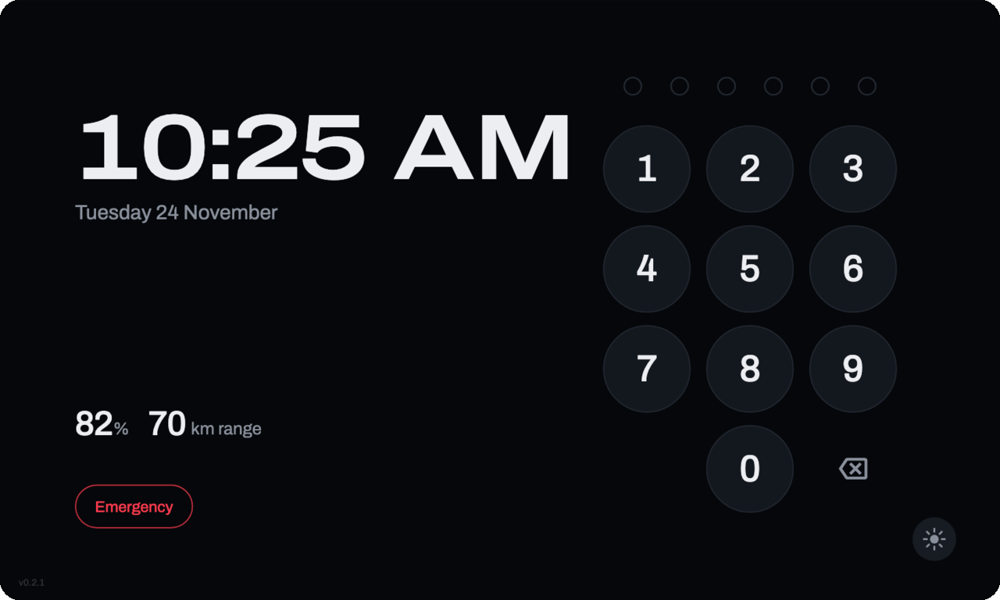

<p align="center">
  
</p>
<h1 align="center">OpenDash</h1>
<p align="center">An open-source replacement dashboard for Ola S1 electric scooters</p>
<div align="center">
  <a href="https://github.com/abhijithvijayan/opendash/blob/main/license">
    
  </a>
  <a href="https://github.com/abhijithvijayan/opendash/releases/latest">
    
  </a>
  <a href="https://twitter.com/intent/tweet?text=Check%20out%20OpenDash%21%20by%20%40_abhijithv%0A%0AAn%20open-source%20dashboard%20for%20Ola%20S1%20scooters%0Ahttps%3A%2F%2Fgithub.com%2Fabhijithvijayan%2Fopendash%0A%0A%23OlaS1Pro%20%23EV%20%23Flutter">
     
  </a>
</div>
<h3 align="center">Made by <a href="https://twitter.com/_abhijithv">@abhijithvijayan</a></h3>
<p align="center">
  Donate:
  <a href="https://www.paypal.me/iamabhijithvijayan" target='_blank'><i><b>PayPal</b></i></a>,
  <a href="https://www.patreon.com/abhijithvijayan" target='_blank'><i><b>Patreon</b></i></a>
</p>
<p align="center">
  <a href='https://www.buymeacoffee.com/abhijithvijayan' target='_blank'>
    
  </a>
</p>
<hr />

<p align="center">
  
</p>

> **OpenDash is an independent community project. It is not made, endorsed or supported by Ola Electric.** Read the [disclaimer](#disclaimer) before you install it.

## Table of Contents

- [What This Is](#what-this-is)
- [Features](#features)
- [Screenshots](#screenshots)
- [Supported Scooters](#supported-scooters)
- [Safety First](#safety-first)
- [Before You Install](#before-you-install)
- [Installing](#installing)
- [Updating](#updating)
- [Scooter Firmware Updates and OTA Shield](#scooter-firmware-updates-and-ota-shield)
- [Going Back to the Stock Dashboard](#going-back-to-the-stock-dashboard)
- [Pulling Logs for a Bug Report](#pulling-logs-for-a-bug-report)
- [Privacy](#privacy)
- [Building from Source](#building-from-source)
- [Related Projects](#related-projects)
- [Issues](#issues)
- [Disclaimer](#disclaimer)
- [Trademarks](#trademarks)
- [License](#license)

## What This Is

Ola S1 scooters with a touchscreen dashboard run Android on it. OpenDash is an Android app that runs on that screen in place of the stock dashboard: a fast, clean, animated instrument cluster with light and dark themes, built with Flutter.

OpenDash is only a screen. It shows what the scooter reports and asks the scooter's own software to do things, the same way the stock dashboard does. The motor, brakes, battery management and locking stay with the scooter's own controllers, which OpenDash does not change.

## Features

- **Riding screen**: speed, drive mode, battery and range, power and regen, odometer and trip, tell-tales and turn signals, cruise and hill-hold state, reverse, km or miles
- **Drive modes look different**: the accent colour changes with the mode
- **Lock screen**: passcode keypad, lockout after wrong attempts, passcode change, handlebar-lock prompts
- **Safety screens**: side stand, fall, accident prompt, alarm, tow and tamper, emergency sheet. They always draw on top, even over another app
- **Charging**: time to full, charger type, charging power, energy added, charge history
- **Settings**: riding features, sounds, display, formats, vehicle information
- **Themes**: light and dark, switched by time of day, custom accents, automatic brightness
- **Bluetooth, media and calls**: pair a phone, now-playing controls, incoming and active call screens
- **Control panel**: quick actions, trip statistics, a performance page
- **Diagnostics**: live battery cells and temperatures, fault flags, stored trouble codes (read only, never cleared)
- **Battery health**: state of health, measured capacity, weak-cell warning, a range learned from your own rides
- **Apps**: an app launcher, phone projection apps, and a small "dash island" that keeps speed and warnings visible over another app
- **Self-update**: checks this repository's releases and installs through Android's own installer, with its confirmation screen
- **Recovery**: safe mode after repeated crashes, and a way back to the stock dashboard

Some stock features are not there yet, and some are built but not yet proven on a scooter. See the [issues](https://github.com/abhijithvijayan/opendash/issues) for what is known.

## Screenshots

Rendered from the app's own code at the scooter's 1280×768 screen size, with the app's built-in demo data.

| | |
|:---:|:---:|
| <br />Light by day, dark by night | <br />Cruise, reverse and hill hold on the dial |
| <br />Performance page | <br />Charging: power, energy, time to full |
| <br />Battery diagnostics, every cell | <br />Quick controls |
| <br />Apps, CarPlay and Android Auto | <br />Lock screen and passcode |

## Supported Scooters

OpenDash is not written for one scooter. It reads what it needs from the stock software installed on the scooter it runs on, so it is meant for any Ola S1 with a touchscreen dashboard. It was built on an S1 Pro Gen 1 and beta tested on Gen 1, Gen 2 and Gen 3 scooters. A build counts as **checked** only after OpenDash has been ridden on exactly that build and the app has been marked to trust it.

| Scooter | Software | Status |
|---|---|---|
| S1 Pro Gen 1 | MoveOS 4 | **Checked.** In daily use |
| S1 Pro Gen 1 | MoveOS 5 | Beta tested |
| S1 Gen 2 | MoveOS 5 | Beta tested |
| S1 Pro Gen 3 | MoveOS 5 | Beta tested |
| Other S1 models and builds | | Not tested. Unknown |

Beta tested builds have been ridden by testers, but only Gen 1 on MoveOS 4 is marked checked in the app. On every other build, OpenDash shows the scooter's data but holds back every command to the scooter until you allow it on screen. Expect missing messages and settings there.

On a model other than the S1 Pro, OpenDash says so once. Some things are still set up for the S1 Pro and may be wrong there: the battery cell and temperature details, the power reading, the speed dial (up to 120 km/h) and the four drive modes. A log from your scooter (see [Pulling Logs](#pulling-logs-for-a-bug-report)) is how support for it gets added.

Thanks to Sid, the first and most thorough tester, to Jacob ([pitzel](https://codeberg.org/pitzel)), and to every beta tester after them.

## Safety First

OpenDash was built so that a mistake in the dashboard cannot make the scooter less safe to ride:

- Safety screens (side stand, faults, low battery, fall, alarm) always draw on top of everything else.
- Commands that change the scooter's state are only sent when the scooter has proven it is stopped, never on a speed reading alone.
- Commands are held back on software builds nobody has ridden yet.
- OpenDash never downloads, installs or accepts a scooter firmware update. It only tells you that one is waiting.
- OpenDash updates itself only through Android's installer, with its confirmation screen. Nothing is installed silently.
- If OpenDash keeps crashing, it starts in a safe mode and offers the way back to the stock dashboard.

Ride as you would with the stock dashboard. If anything on screen looks wrong, stop somewhere safe and switch back to the stock dashboard.

## Before You Install

- **You need adb access to the scooter's head unit.** The scooter does not offer this out of the box. How to get it on a Gen 1 is described in [ola-s1-pro-gen1](https://github.com/abhijithvijayan/ola-s1-pro-gen1#getting-access). [OpenDash Companion](#with-your-phone-recommended) shows the phone's adb key to add once you have it. Only do this on a scooter you own.
- **The stock dashboard stops while OpenDash is the home screen.** On Gen 1, a few stock services are started only by the stock dashboard and do not run under OpenDash: cloud notifications, AI range, AI indicator auto-off, group rides and the built-in navigation.
- **Everything behind the dashboard keeps running as before**: the scooter's telemetry and its uploads to the manufacturer, remote commands from the phone app, the scooter's firmware updater, the motor sound and chimes. The one exception is OTA Shield, a separate app you can choose to install; see [Scooter Firmware Updates and OTA Shield](#scooter-firmware-updates-and-ota-shield).
- **Installing changes the head unit's display density.** Uninstalling puts it back.
- **It may affect your warranty.** Read the [disclaimer](#disclaimer).

## Installing

### With your phone (recommended)

[**OpenDash Companion**](https://github.com/abhijithvijayan/opendash-companion) is an Android app that installs OpenDash over the scooter's own network. No computer, no command line.

1. **Get the app, once.** OpenDash Companion isn't on the Play Store: on an Android phone (Android 10 or later), open [its latest release](https://github.com/abhijithvijayan/opendash-companion/releases/latest), download `opendash-companion-<version>.apk` and install it. From then on it updates itself.
2. Put the phone on the same Wi-Fi as the scooter, on the scooter's hotspot, or share the phone's hotspot with the scooter.
3. Open the app, tap **Scan** (or type the scooter's address) and connect. If the scooter doesn't accept the phone yet, the app shows the phone's adb key to add (see [Before You Install](#before-you-install)).
4. With the scooter parked, tap **Install OpenDash**. You don't download OpenDash yourself: the app fetches the latest release, checks it against OpenDash's release key (below), installs it, sets the display density, turns off the screensaver, makes OpenDash the home screen and starts it.

The same app tells you when a new OpenDash is out and installs it, installs a build from a file, removes OpenDash and puts the stock dashboard back, and lets you remove other apps installed on the scooter.

<p align="center">
  
  
</p>

### With a computer

For developers, and for anyone who'd rather use adb and the scripts in this repository.

#### 1. Get the tools

| Tool | What it's for | macOS | Windows | Linux |
|------|--------------|-------|---------|-------|
| **Git** | Clone this repo | `brew install git` | [git-scm.com](https://git-scm.com/download/win) | `sudo apt install git` |
| **ADB** | Install the app on the scooter | `brew install android-platform-tools` | [SDK Platform Tools](https://developer.android.com/tools/releases/platform-tools) (add to PATH) | `sudo apt install android-tools-adb` |

On Windows, run the scripts from Git Bash or WSL.

#### 2. Connect to the scooter

Your computer and the scooter must be on the **same Wi-Fi network**. Find the scooter's IP address in your router's list of connected devices, or with a network scanner app such as [Fing](https://www.fing.com/products/fing-app).

Authorise adb on the scooter (see [Before You Install](#before-you-install)), then check that it answers:

```bash
adb connect <scooter-ip>:5555
adb -s <scooter-ip>:5555 shell echo ok
```

#### 3. Download OpenDash

Download the latest `opendash-<version>.apk` from [Releases](https://github.com/abhijithvijayan/opendash/releases/latest) into a folder.

#### 4. Check the download (recommended)

Every official release is signed with one key. The SHA-256 fingerprint of its certificate is:

```
25:F0:12:A3:3B:86:AB:23:65:B4:80:B5:94:99:8A:13:1F:A8:E0:ED:C3:76:8C:9E:25:84:40:F9:8D:4B:A7:EE
```

Check an APK against it with `apksigner` (in the Android SDK build-tools):

```bash
apksigner verify --print-certs opendash-<version>.apk | grep SHA-256
```

The package name is `in.abhijithvijayan.opendash`. An APK with that name signed by any other key is not an official build. Android also refuses to install an update signed by a different key over an installed one.

#### 5. Install

```bash
git clone https://github.com/abhijithvijayan/opendash.git
cd opendash
bash scripts/install.sh <scooter-ip> <folder-with-the-apk>
```

The script installs the newest OpenDash APK in that folder, sets the display density, turns off the screensaver, makes OpenDash the home screen and starts it. Pass `--no-home` to install without making it the home screen.

<details>
<summary>Installing by hand, without the script</summary>

```bash
adb -s <scooter-ip>:5555 shell wm density 160
adb -s <scooter-ip>:5555 shell settings put secure screensaver_enabled 0
adb -s <scooter-ip>:5555 install -r -g opendash-<version>.apk
adb -s <scooter-ip>:5555 shell cmd package set-home-activity in.abhijithvijayan.opendash/.MainActivity
adb -s <scooter-ip>:5555 shell am start -n in.abhijithvijayan.opendash/.MainActivity
```

</details>

### Or install from your phone with Axiom

[Axiom](https://codeberg.org/pitzel/axiom), an Android app by Jacob, one of OpenDash's beta testers, can also install an OpenDash APK you downloaded straight from your phone, with no computer. It connects to the scooter over your phone's hotspot. See its README for what it needs and which scooters it works with. OpenDash Companion and the install script also set the display density, turn off the screensaver and make OpenDash the home screen, so make sure those are done too.

## Updating

OpenDash checks this repository's releases by itself. When a new version is out, it offers it in **Settings → Updates**, downloads it, and hands it to Android's installer, which asks you to confirm. Updates are offered only while the scooter is parked.

OpenDash Companion also tells you when a new version is out, each time you open it, and installs it from your phone. From a computer, install a newer APK with `scripts/install.sh` as above, at any time.

## Scooter Firmware Updates and OTA Shield

OpenDash never downloads, installs or accepts a firmware update for the scooter. When the scooter says one is waiting, OpenDash tells you, and you can open the stock dashboard to install it.

Some riders want to stop firmware updates from arriving at all. [OTA Shield](https://codeberg.org/pitzel/ota-shield) is a separate, optional app that does this. It is made by another developer, not by OpenDash. OpenDash can install it from its Apps screen, shows its status in **Settings → Updates**, and can switch it on, but turning it off is done in OTA Shield itself.

Before you install it, know what it does:

- **It holds back every firmware update**, including ones that fix safety problems or that the manufacturer sends as part of a recall. If you use it, keep an eye on the manufacturer's notices and recalls, and install important updates yourself.
- **It sits between the scooter and the manufacturer's cloud.** It needs root on the head unit, adds its own certificate to the ones the system trusts, and reads the scooter's encrypted traffic to the manufacturer so that it can drop update messages. Everything else is passed on, so the phone app keeps working.
- This goes further than replacing the dashboard. It may break the terms of the scooter's connected services and affect your warranty more than OpenDash alone.

If OTA Shield cannot start its block when the scooter powers on, its fail-safe may cut the scooter off from the manufacturer's cloud completely, and the phone app stops working until the block starts. OpenDash shows this in **Settings → Updates**.

## Going Back to the Stock Dashboard

In OpenDash Companion, tap **Uninstall OpenDash**. It gives the home screen back to the stock dashboard and resets the display density.

From a computer, to make the stock dashboard the home screen again and remove OpenDash:

```bash
bash scripts/uninstall.sh <scooter-ip>
```

To keep OpenDash installed but switch the home screen back to stock:

```bash
adb -s <scooter-ip>:5555 shell cmd package set-home-activity com.olaelectric.hmiclient/.MainActivity
```

OpenDash can also open the stock dashboard from **Settings → Developer**.

## Pulling Logs for a Bug Report

OpenDash keeps a local log of what happened on the scooter, to make bugs easier to find. Nothing is uploaded.

**From your phone:** in OpenDash Companion, connect to the scooter and tap **Share logs**. Pick OpenDash's log, the app's own log and, for a wrong reading or a fault, the CAN bus recordings; it zips them and opens the share sheet, so you can save it or attach it to an issue. **Report a problem** opens a new issue with the versions filled in.

**From a computer:**

```bash
bash scripts/pull-logs.sh <scooter-ip>
```

The logs land in `logs/logs-<date-time>/`. Attach them to an [issue](https://github.com/abhijithvijayan/opendash/issues/new) along with what you were doing and roughly when.

The log is written so that it can be shared: identifiers such as the VIN, serial numbers, phone names and network names are left out or masked before anything is written. Still, read it before you post it publicly. The log can be turned off in **Settings → Developer**.

## Privacy

- OpenDash has no account and no analytics service. Nothing that identifies you or the scooter leaves the scooter because of OpenDash.
- **Anonymous install count.** So we know how many scooters run OpenDash and which versions are still in use, OpenDash sends one small message at most once a week to a server of ours ([`server/usage`](server/usage)). This is the whole message:

  ```json
  {"v":2,"week":"2026-W48","new":false,"app":"0.3.0","build":30000,"gen":"1","model":"S1 Pro","moveos":"4.6.14","stock":"4.6.14","android":"10"}
  ```

  `new` is true only on the first message after an install. The app also attaches a few seconds' worth of proof of work to each message, so that faking many messages costs real computing time. There is no ID of any kind, so two messages cannot be told to come from the same scooter. The server keeps the country the message came from and does not keep your IP address. Turn it off in **Settings → Updates → Count this install**; once off, nothing is sent.
- Apart from that message, OpenDash only talks to GitHub (to check for its own updates and those of the apps it offers) and uses Cloudflare's public DNS to look up addresses when the mobile network's own DNS fails. None of these requests carries anything about the rider or the scooter.
- The stock software behind the dashboard keeps reporting to the manufacturer exactly as it does with the stock dashboard. OpenDash neither adds to nor blocks that. If you install [OTA Shield](#scooter-firmware-updates-and-ota-shield), that app reads the scooter's traffic to the manufacturer and drops firmware update messages; OpenDash only reads its status.

## Building from Source

OpenDash is a Flutter app. You do not need a scooter to work on the interface: without one, it runs on mock data, with a developer panel (bottom right) to drive speed, modes, charging and more.

```bash
flutter pub get
flutter run -d chrome     # the dashboard in a browser, on mock data
flutter test
flutter analyze
```

To build and install your own build on a scooter (adb authorised as above):

```bash
bash scripts/deploy.sh <scooter-ip>
```

A build signed with your own key cannot be installed over a release build, and the reverse. Uninstall first when switching between them.

## Related Projects

- [**OpenDash Companion**](https://github.com/abhijithvijayan/opendash-companion): the Android phone app that installs, updates and removes OpenDash
- [**ola-s1-pro-gen1**](https://github.com/abhijithvijayan/ola-s1-pro-gen1): research notes and access tools for the Gen 1 head unit
- [**OlaMate**](https://github.com/abhijithvijayan/olamate): battery health and ride telemetry logger
- [**Axiom**](https://codeberg.org/pitzel/axiom): CAN telemetry, fault reader and system tool for Ola scooters, an Android app that can also install OpenDash

## Issues

_Looking to contribute? Look for the [Good First Issue](https://github.com/abhijithvijayan/opendash/issues?q=is%3Aissue+is%3Aopen+sort%3Aupdated-desc+label%3A%22good+first+issue%22) label._

### 🐛 Bugs

Please file an issue [here](https://github.com/abhijithvijayan/opendash/issues/new) for bugs, missing documentation, or unexpected behavior. Say which scooter and software version you have (shown in Settings), and attach logs if you can.

[**See Bugs**](https://github.com/abhijithvijayan/opendash/issues?q=is%3Aissue+is%3Aopen+sort%3Aupdated-desc+label%3Abug)

## Disclaimer

OpenDash is provided **as is**, without warranty of any kind, and you use it **entirely at your own risk**.

- It is an independent, free and open-source community project. It is not made, endorsed, sponsored or supported by Ola Electric Mobility Ltd. or any of its affiliates.
- Installing it requires access to your scooter's head unit that the manufacturer does not offer. Doing so, or running a third-party dashboard, may void your warranty, and the manufacturer or its service centres may refuse support while it is installed.
- A manufacturer software update may change or remove OpenDash, or stop it from working.
- Blocking firmware updates with a third-party app such as OTA Shield also blocks safety fixes and recall updates. That is your choice and your responsibility.
- A dashboard shows information that matters while riding. OpenDash may show something wrong or miss something the stock dashboard would show. Do not rely on it alone, keep your eyes on the road, and follow the traffic laws where you ride.
- Use it only on a scooter you own, or with the owner's permission.
- The authors and contributors are not liable for any damage to your scooter, injury, loss, fine, or any other consequence of using it.

**What is in this repository.** OpenDash is original work. It contains no code, firmware, images, sounds or fonts from Ola Electric or from the scooter's software, and no part of the stock software is redistributed here or in the app. To work together with the scooter, OpenDash uses facts about it that were learned by studying a scooter the authors own, for the sole purpose of interoperability, with help from owners who tested beta builds on their own scooters: the names of the messages it exchanges with the scooter's software, and, for the Diagnostics screen, the scooter's fault codes, the names of its fault flags and short descriptions of what each code means, taken from the diagnostic definitions found on the scooter. Where it can, the app reads what it needs from the software already installed on each scooter. The font used is [Archivo](https://fonts.google.com/specimen/Archivo), under the SIL Open Font License.

## Trademarks

Ola, Ola Electric, S1, S1 Pro and MoveOS are trademarks of their respective owners. They are used here only to say which scooters OpenDash works with. That use does not imply any affiliation with or endorsement by them.

Android, Android Auto and Flutter are trademarks of Google LLC. CarPlay is a trademark of Apple Inc.

## License

Copyright © Abhijith Vijayan

OpenDash is free software: you can redistribute it and/or modify it under the terms of the GNU General Public License as published by the Free Software Foundation, either version 3 of the License, or (at your option) any later version.

OpenDash is distributed in the hope that it will be useful, but WITHOUT ANY WARRANTY; without even the implied warranty of MERCHANTABILITY or FITNESS FOR A PARTICULAR PURPOSE. See the [GNU General Public License](license) for more details.

If you share a modified build of OpenDash, the license requires you to publish its source under the same terms, so riders can see what it does to their scooter.
